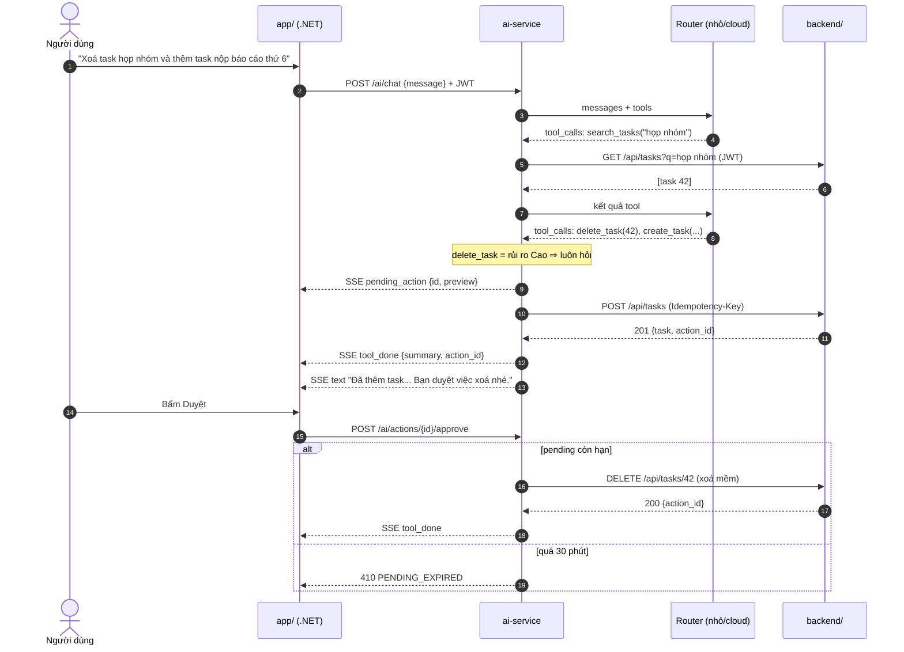

# AI Harness — Đề xuất Thiết kế Kỹ thuật (RFC)

Tệp đích `specs/ai-harness/02-rfc.md`; luật phân vùng: [`../CLAUDE.md`](../CLAUDE.md). Căn cứ: [`01-research.md`](01-research.md). Câu hỏi đã chốt chuyển sang [`03-decisions.md`](03-decisions.md).

## 1. Kiến trúc đề xuất

- **App (.NET)**: gửi text (gõ, hoặc STT trên máy) + JWT tới `POST /ai/chat`, đọc stream SSE, vẽ thẻ xác nhận, thực thi `client_action`.
- **AI service (FastAPI)**: vòng lặp agent; mỗi tool call qua `permission.py` → chạy ngay, hoặc lưu `pending_action` chờ duyệt.
- **Router LiteLLM**: chọn model nhỏ hoặc cloud theo loại việc; fallback khi lỗi.
- **BE (.NET)**: REST cho từng tool server, kiểm quyền theo resource, ghi `action_log`, cung cấp undo.

## 2. So sánh phương án

| Câu hỏi | Phương án | Được | Mất | Chọn |
|---|---|---|---|---|
| AI thao tác app bằng gì | A. Tool gọi API BE · B. Điều khiển giao diện từng nền tảng | Một harness cho 3 nền tảng, nhanh (1 HTTP call/thao tác), test được bằng eval | B: iOS không cho app điều khiển app khác; mỗi bước vài giây; vỡ khi đổi giao diện | A (Người dùng chốt 26/11) |
| AI service ở đâu | A. Python riêng · B. C# trong BE .NET | Hệ sinh thái LLM/eval đầy đủ, ban AI làm độc lập | B: ít service hơn nhưng phụ thuộc lịch bạn BE | A (Người dùng chốt) |
| Model | A. Cloud · B. Lai, local trước · C. Tự host + fine-tune | B: không tốn token lúc dev, có "model riêng" cho slide, vẫn ổn định nhờ 2 tầng cloud | A: tốn token, phụ thuộc bên thứ ba · C: GPU sập/quá tải = lỗi trước giám khảo | B (Người dùng chốt) |
| Database | A. Supabase Postgres · B. DB riêng của BE + SQLite cho AI | A: một nơi, có bản free, xem dữ liệu khi demo | B: hai nơi phải deploy/backup | A (Người dùng chốt) |
| Mức tự chủ | A. Luôn hỏi · B. Theo rủi ro · C. Tự động · D. Cho người dùng chọn | D giữ "human centered", mặc định B cân bằng | A phiền, C mất kiểm soát | D, mặc định B (Người dùng chốt) |
| Đầu vào | Chat · giọng nói · tài liệu · AI chủ động | Đủ 4 kênh, chung một vòng lặp | Thêm việc FE | Cả 4 (Người dùng chốt) |
| Nối BE bằng gì | A. REST + JWT người dùng · B. Đọc thẳng DB | A: BE giữ quyền, không lộ dữ liệu người khác | B: nhanh hơn nhưng bỏ qua kiểm quyền và `action_log` | A |
| Trả kết quả | A. SSE · B. WebSocket · C. JSON một lần | A: một chiều đủ dùng, dễ trên .NET (`HttpClient` đọc stream) | B: phức tạp hơn · C: người dùng chờ lâu | A |

## 3. Câu hỏi mở

1. **Model `cloud` và `cloud_backup` cụ thể** (vd Gemini Flash + OpenAI mini, hoặc Bedrock nếu có credit) — 👤 Trưởng ban AI, hạn 27/11 (Giai đoạn 1 chạy local, chưa cần).
2. **Framework client** (.NET MAUI? Uno? Blazor Hybrid?) và **có bản web không** — 👤 bạn FE, hạn 26/11. Ảnh hưởng cách STT và thông báo cục bộ.
3. **App cài đặt có được tính "dùng thử trực tuyến" không** — 👤 Trưởng nhóm gửi `techday@mservice.com.vn` trước 23:59 ngày 27/11.
4. **Được dùng API model ngoài AWS kết hợp model tự host không** — 👤 Trưởng nhóm, cùng email trên.
5. **Nơi deploy AI service + BE** (VPS, Render, Railway, AWS) — 👤 cả đội, hạn 27/11.
