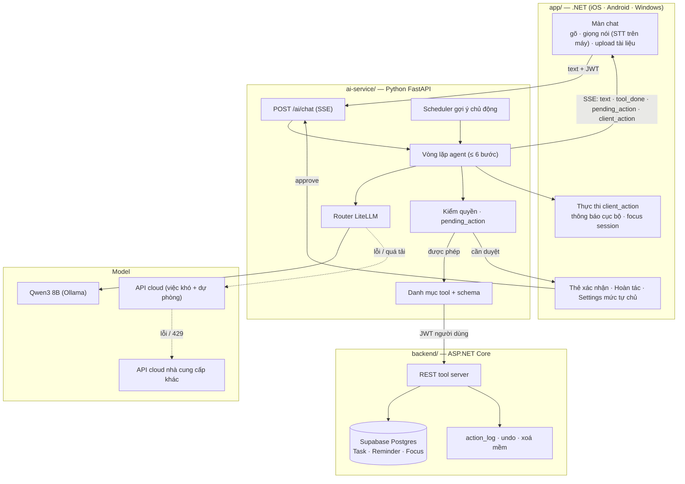

# Feature: AI Harness — Tay chân của Trợ lý AI cá nhân

Tệp đích `specs/ai-harness/README.md`; luật phân vùng: [`../CLAUDE.md`](../CLAUDE.md). Tiến độ: [`index.md`](index.md). Gói này đặc tả **AI service** và **hợp đồng** mà AI service cần từ `backend/` và `app/`; màn hình quản lý task thường (danh sách, lịch, CRUD tay) thuộc gói của BE/FE, không thuộc gói này.

> [!IMPORTANT]
> Bối cảnh cuộc thi MoMo Tech Contest 2026 (chủ đề *Trợ lý AI → Trợ lý cá nhân*). Ba ràng buộc chi phối mọi quyết định:
> 1. Ban giám khảo **tự dùng thử online**, không phụ thuộc máy của đội; bản đang chạy **không được sửa sau 23:59 ngày 03/12/2026** (Thể lệ Điều 31.4).
> 2. **AI là thành phần cốt lõi**, không phải tính năng phụ (đề bài, mục *Yêu cầu sản phẩm*).
> 3. Đội **nộp bản chính trước 20:00 ngày 02/12/2026**; 03/12 chỉ để sửa lỗi nặng và nộp lại (Người dùng chốt, 26/11).

**Vị trí mã nguồn**

| Layer | Đường dẫn | Trách nhiệm |
|---|---|---|
| API vào | `ai-service/app/api/` (`chat.py`, `actions.py`, `proactive.py`) | `POST /ai/chat` (SSE), duyệt/bỏ `pending_action`, chạy thử gợi ý chủ động |
| Vòng lặp agent | `ai-service/app/agent/` (`loop.py`, `prompt.py`, `context.py`) | Gọi model, nhận tool call, kiểm quyền, chạy tool, trả SSE; giới hạn 6 bước |
| Danh mục tool | `ai-service/app/tools/` (`registry.py`, `server_tools.py`, `client_tools.py`, `schemas.py`) | Schema Pydantic, mô tả tiếng Việt, mức rủi ro, nơi chạy của từng tool |
| Quyền & hoàn tác | `ai-service/app/policy/` (`permission.py`, `pending.py`) | Ma trận chế độ × rủi ro, lưu `pending_action` TTL 30 phút |
| Định tuyến model | `ai-service/app/llm/` (`router.py`, `health.py`) | LiteLLM: model nhỏ ↔ cloud, fallback, health check |
| Tài liệu → cây task | `ai-service/app/docs/` (`extract.py`, `planner.py`) | Trích văn bản `.md/.txt/.pdf`, sinh cây task JSON |
| Gợi ý chủ động | `ai-service/app/proactive/` (`scheduler.py`, `triggers.py`) | Kế hoạch buổi sáng, trễ deadline, deadline < 24 giờ |
| Đánh giá | `ai-service/eval/` (`cases.jsonl`, `run_eval.py`) | 80 câu lệnh tiếng Việt, chấm tool/tham số/thời gian |
| Hợp đồng BE | `backend/` (route trong [`05-spec.md`](05-spec.md) mục 4.3) | REST cho tool server, `action_log`, undo, xoá mềm |
| Hợp đồng FE | `app/` (sự kiện SSE trong [`05-spec.md`](05-spec.md) mục 4.1) | Màn chat, thẻ xác nhận, Hoàn tác, Settings, thực thi `client_action` |

---

## 1. Tầm nhìn & định vị

- **Vấn đề thực tế**: Người dùng có việc mơ hồ ("làm xong module thanh toán") nhưng không biết chia nhỏ, đặt ưu tiên, nhắc lịch; các app task hiện có bắt người dùng tự gõ từng task, tự kéo thả ưu tiên. File brainstorm của đội ghi: *"Task quá unclear → AI trợ lý lập kế hoạch task hợp lý nhất"*.
- **Định vị giải pháp**: Một lớp "tay chân" cho trợ lý: người dùng nói bằng tiếng Việt (gõ, nói hoặc đưa tài liệu), AI **tự thao tác** trong app — thêm task, chia cây task, đặt ưu tiên, nhắc nhở, mở focus — trên iOS, Android, Windows, và người dùng luôn xem lại, duyệt hoặc hoàn tác được.
- **Tôn chỉ thiết kế**:
  - *Giao quyền nhưng không mất kiểm soát*: mức tự chủ do người dùng chọn; thao tác rủi ro cao luôn hỏi; mọi thao tác ghi đều hoàn tác được.
  - *Ổn định hơn nhiều tính năng*: giám khảo test lúc nào cũng phải chạy; có đường lùi cho mọi phụ thuộc ngoài (model, GPU).
  - *Một harness, ba nền tảng*: AI không bấm giao diện; mọi thao tác đi qua tool nên chạy giống nhau ở mọi client.

---

## 2. Nguyên lý kiến trúc

- **Tool thay cho bấm giao diện**: AI chỉ tác động hệ thống qua danh mục tool có schema; tool server gọi REST của BE, tool client trả `client_action` cho app tự chạy (`QĐ-HARNESS-001`).
- **Quyền kiểm bằng code, không bằng prompt**: trước mỗi tool call, `permission.py` tra ma trận chế độ × rủi ro; model không thể "quên" hỏi (`QĐ-HARNESS-004`, `QĐ-HARNESS-005`).
- **Đảo ngược được**: mọi tool ghi sinh một dòng `action_log` có trạng thái trước/sau; xoá là xoá mềm (`QĐ-HARNESS-006`).
- **Hạ cấp êm khi hỏng**: model nhỏ lỗi/chậm ⇒ tự sang cloud; cloud lỗi ⇒ báo lỗi rõ ràng và không ghi gì nửa vời (`QĐ-HARNESS-007`).

---

## 3. Sơ đồ kiến trúc & quy trình

---

## 4. Danh mục công nghệ chốt

- **AI service**: Python 3.12, FastAPI, Pydantic v2, `sse-starlette`, `httpx`, LiteLLM, APScheduler (gợi ý chủ động), `pypdf` (trích PDF), `asyncpg` (Supabase).
- **Database**: Supabase Postgres; schema `public` của BE, schema `ai` của AI service (`QĐ-HARNESS-017`).
- **Model nhỏ (chính cho chat)**: Qwen3 8B qua Ollama, chạy local từ Giai đoạn 1; prod trên server GPU nếu qua cổng `QĐ-HARNESS-008`.
- **Model cloud**: một model Flash/mini giá rẻ có function calling làm `cloud`, một model của nhà cung cấp khác làm `cloud_backup`. Chọn cụ thể ở `02-rfc.md` câu hỏi mở 1.
- **BE / FE**: .NET của hai bạn đồng đội; gói này chỉ ràng buộc hợp đồng ở `05-spec.md` mục 4.
- Căn cứ chọn: [`01-research.md`](01-research.md) mục 2.

---

## 5. Đánh đổi kiến trúc

| Hạng mục | Chọn | Từ chối | Căn cứ |
|---|---|---|---|
| AI thao tác app bằng gì | Tool gọi API BE + `client_action` | Điều khiển giao diện (UI automation) — mỗi nền tảng một kiểu, dễ vỡ, chậm | `QĐ-HARNESS-001` |
| AI service đặt ở đâu | Service Python riêng | Nhúng vào BE .NET (Semantic Kernel) — hệ sinh thái eval/LLM mỏng hơn, phải phối hợp chặt với bạn BE | `QĐ-HARNESS-002` |
| Model | Lai, local trước: Qwen3 8B → cloud → cloud dự phòng | Chỉ tự host — GPU sập/quá tải là giám khảo thấy lỗi; cloud trước — tốn token lúc phát triển | `QĐ-HARNESS-007`, `008` |
| Database | Supabase Postgres, AI chỉ có schema `ai` | AI đọc thẳng bảng task bằng `service_role` — vượt kiểm quyền | `QĐ-HARNESS-017` |
| Xác nhận | 3 chế độ, mặc định theo rủi ro | Luôn hỏi (phiền) · không bao giờ hỏi (mất kiểm soát) | `QĐ-HARNESS-004` |
| Giọng nói | STT trên máy, gửi text | Gửi audio lên cloud — tốn quota, thêm độ trễ | `QĐ-HARNESS-011` |

---

## 6. Bất biến hệ thống

- [`05-spec.md`](05-spec.md) mục 1 (`[INV-HARNESS-01]`..`11`).

---

## 7. Non-goals & anti-patterns

**Cố tình không làm** (`QĐ-HARNESS-016`):
- Không điều khiển giao diện app hay app khác (bấm, gõ thay người dùng).
- Không thanh toán, không đụng tài khoản MoMo thật (BTC không cấp API MoMo — FAQ).
- Không fine-tune trước khi có số đo eval; không train model từ đầu.
- Chặn app khi focus ở cấp hệ điều hành (Screen Time iOS…) để P2, có thể bỏ.

**Cấm**:
- Cấm để model tự quyết có cần hỏi người dùng hay không — quyền kiểm bằng code.
- Cấm coi chữ trong tài liệu upload hay kết quả tool là lệnh của người dùng.
- Cấm AI service dùng tài khoản hệ thống có quyền trên mọi user; luôn đi bằng JWT của người dùng.
- Cấm gửi cả lịch sử chat lên model (tốn quota); chỉ 10 lượt gần nhất + tóm tắt.
- Cấm sửa code/server sau 23:59 ngày 03/12/2026.

---

## 8. Miền kiểm chứng điển hình

| Miền | Thách thức | Thành quả |
|---|---|---|
| "Thêm task nộp báo cáo thứ 6, ưu tiên cao" | Ngày tương đối, tiếng Việt không dấu/viết tắt | Task đúng ngày giờ, ưu tiên 1, dòng "Đã tạo · Hoàn tác" trong chat |
| Upload SRS 5 trang | Việc lớn mơ hồ, người dùng không biết chia | Cây Project → Task → Task con có ước lượng, xem trước rồi duyệt |
| "Sắp xếp lại việc tuần này giúp tôi" | Sửa hàng loạt dễ sai | Thẻ xác nhận liệt kê thay đổi trước/sau; Hoàn tác cả lượt |
| GPU model nhỏ sập lúc giám khảo test | Lỗi lộ ra giao diện | Router chuyển sang cloud, người dùng không thấy lỗi |
| Sáng mở app | Không biết bắt đầu từ đâu | Thẻ gợi ý 3 việc quan trọng nhất, duyệt một chạm |

---

## 9. Tham chiếu

- Tiến độ: [`index.md`](index.md) · khảo sát: [`01-research.md`](01-research.md) · luật: [`../CLAUDE.md`](../CLAUDE.md)
- Đề bài: <https://techday.momo.vn/topic.html> · Thể lệ: <https://techday.momo.vn/assets/docs/the-le-cuoc-thi.pdf>
