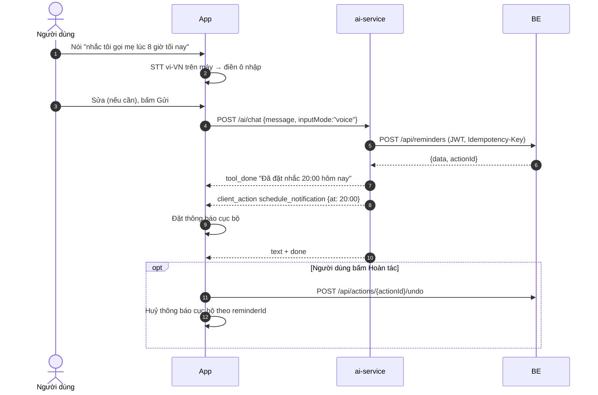

# Luồng: Ra lệnh bằng chat hoặc giọng nói

Tệp đích `specs/ai-harness/ui/flows/01-chat-command.md`; quy chuẩn UI: [`../README.md`](../README.md); đặc tả khung: [`../../05-spec.md`](../../05-spec.md) mục 3.1–3.3; chỉ mục: [`../../index.md`](../../index.md).

## 1. Sơ đồ

## 2. Điểm FE phải làm

- Hoàn tác `create_reminder` ⇒ huỷ thông báo cục bộ có cùng `reminderId`.
- Mất mạng khi đang stream ⇒ hiện "Mất kết nối", nút Thử lại gửi lại **cùng nội dung**; AI service chống trùng nhờ `Idempotency-Key`.
