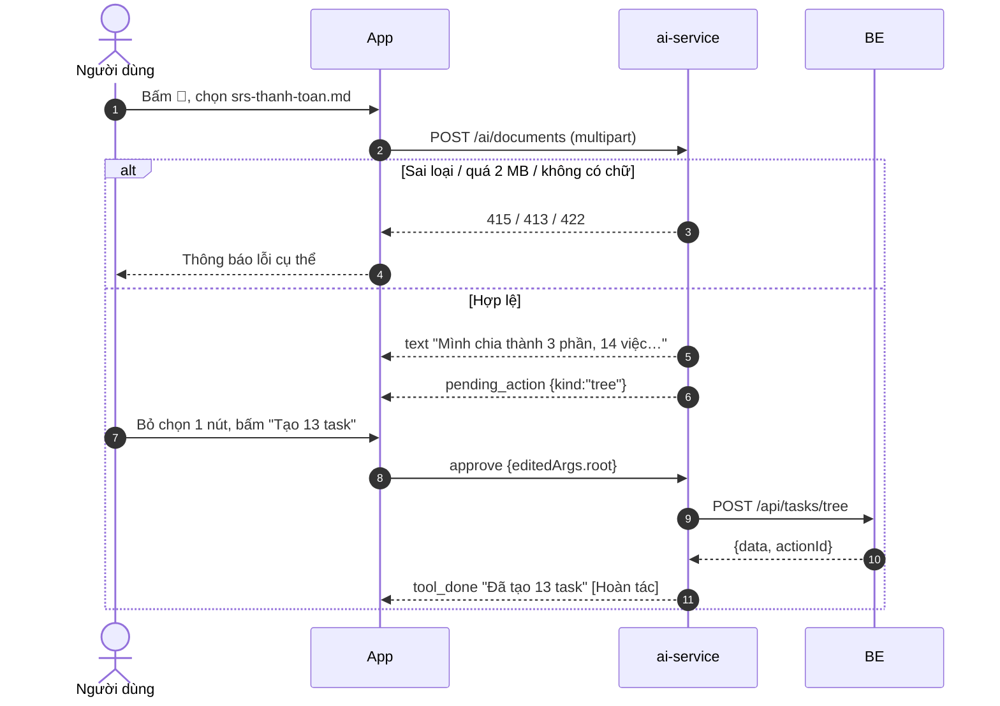

# Luồng: Tài liệu → Cây task

Tệp đích `specs/ai-harness/ui/flows/02-doc-to-tree.md`; quy chuẩn UI: [`../README.md`](../README.md); mô-đun: [`../../modules/05-doc-to-task-tree.md`](../../modules/05-doc-to-task-tree.md); chỉ mục: [`../../index.md`](../../index.md).

## 1. Sơ đồ

## 2. Điểm FE phải làm

- Dựng cây có checkbox từ `preview.items`; bỏ chọn nút cha ⇒ bỏ cả con.
- Hiện tổng số task và tổng giờ ước lượng cập nhật theo lựa chọn.
