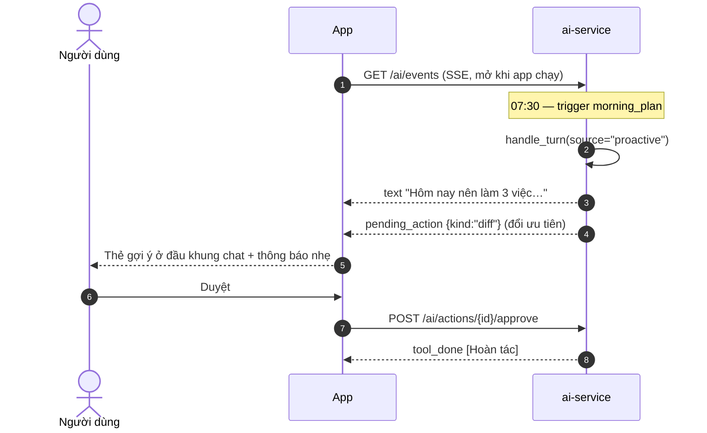

# Luồng: Gợi ý chủ động

Tệp đích `specs/ai-harness/ui/flows/03-proactive-suggestion.md`; quy chuẩn UI: [`../README.md`](../README.md); mô-đun: [`../../modules/06-proactive.md`](../../modules/06-proactive.md); chỉ mục: [`../../index.md`](../../index.md).

## 1. Sơ đồ

## 2. Điểm FE phải làm

- Thẻ gợi ý có nhãn "Trợ lý gợi ý" để phân biệt với trả lời cho lệnh của người dùng.
- Nút **Chạy thử gợi ý buổi sáng** (tài khoản demo) gọi `POST /ai/proactive/run?trigger=morning_plan` và hiển thị như trên.
